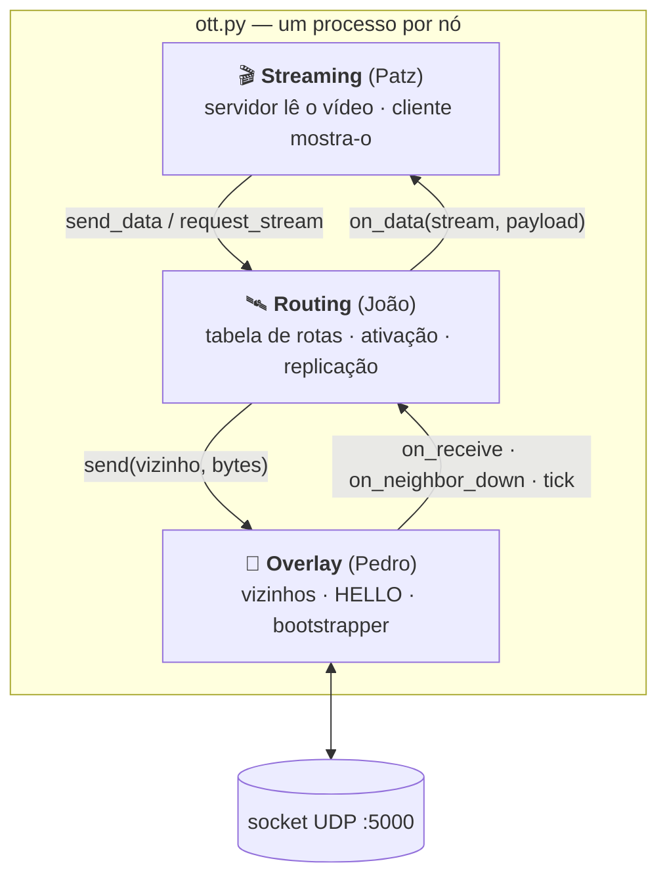
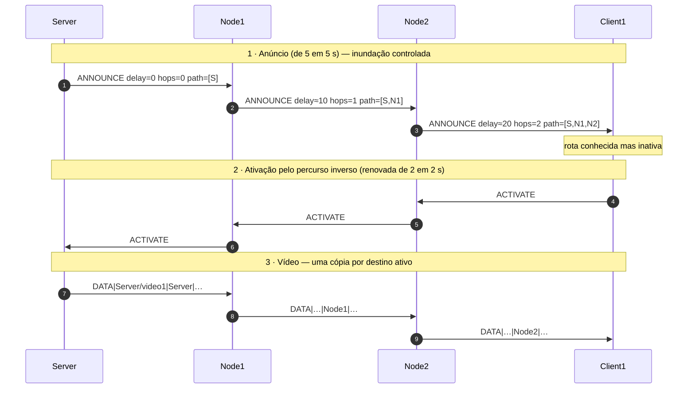

# 🛰️ Módulo 2 — Routing

> **Por onde passa cada vídeo, e para quem.**
> O *router* constrói as rotas desde os servidores até aos clientes, ativa apenas os ramos que têm alguém a ver, replica o vídeo só onde os caminhos se separam e muda de caminho quando a rede muda.

**ESR · TP2 2026/27** · Serviço *Over the Top* para entrega de multimédia · Etapas 2 e 3 do enunciado · responsável: João

| | |
|---|---|
| 📡 **Métrica** | 1.º atraso medido · 2.º número de saltos (desempate) |
| 🌳 **Distribuição** | Árvore por fluxo, uma cópia por ligação |
| 🔁 **Adaptação** | Falhas de nós e mudanças de atraso, sem ciclos |
| ✅ **Testes** | 27 automáticos + Cenário 2 no CORE |

---

## 🧩 Onde encaixa no projeto

Cada máquina do *overlay* corre o mesmo programa, [`ott.py`](../ott.py), que junta os três módulos num só processo com um *socket* UDP na porta 5000.



O *router* **não abre sockets nem conhece IPs**: fala só em nomes de nós (`Node1`, `Client2`). O *overlay* trata dos endereços e o *streaming* trata do conteúdo, que para o *router* são bytes opacos. O contrato entre os três módulos está em [`INTERFACES.md`](../INTERFACES.md).

---

## ⚙️ Como funciona



1. **📣 Anúncio.** De 5 em 5 s, cada servidor anuncia os seus fluxos. Cada nó soma o atraso da ligação por onde o anúncio chegou e mais um salto, junta-se ao `path` e reenvia aos outros vizinhos. Só reenvia a 1.ª cópia de cada ronda, ou uma cópia melhor, e nunca para trás. Assim, a ronda termina sozinha.
2. **💤 Rotas inativas.** Todos os nós ficam a saber qual é o melhor vizinho em direção ao servidor (a **origem**), mas enquanto não houver clientes não passa vídeo.
3. **🙋 Ativação.** O cliente envia `ACTIVATE` à origem, que o reenvia à sua própria origem, e assim até ao servidor. Cada nó pelo caminho regista quem pediu (os **destinos**). O pedido é *soft state*: se não for renovado em 6 s, o ramo desliga-se sozinho.
4. **🌳 Replicação.** Cada pacote vai uma vez a cada destino. Num troço comum segue uma única cópia, que só se divide onde os caminhos se separam.
5. **🔁 Adaptação.** Se um vizinho cai, o nó passa para a melhor alternativa que já conhecia. Se um link fica lento ou rápido, o anúncio seguinte escolhe o novo melhor caminho.
6. **🏓 PING (Etapa 3).** O servidor envia `PING` pelas rotas ativas, e cada nó regista no *log* o caminho percorrido.

### 📏 A métrica

| Critério | Regra |
|---|---|
| **1.º atraso** | Ganha o menor atraso até ao servidor. É medido com `PROBE`/`PROBE_REPLY` de 1 em 1 s: o atraso da ligação é RTT/2, suavizado por uma média móvel. Não é preciso sincronizar relógios. |
| **2.º saltos** | Só desempata quando os atrasos são **iguais**, ou seja, quando diferem no máximo **2 ms ou 10 %**. |
| **Empate total** | Qualquer um serve: fica a origem atual, para a rota não oscilar. |

A tolerância existe porque o atraso medido nunca é exatamente igual. Sem ela, o 2.º critério nunca seria usado e o ruído das medições faria a rota mudar constantemente.

### 🛡️ Sem ciclos

Com o atraso em primeiro lugar, uma rota antiga pode parecer melhor do que a verdadeira. Três regras impedem que isso crie ciclos:

- **`path` no anúncio:** um nó ignora anúncios que já passaram por ele.
- **Métrica da própria cópia:** um anúncio é reenviado com a métrica com que chegou, nunca com uma rota guardada de uma ronda antiga.
- **Só a ronda atual conta**, como no DSDV. A origem atual tem 1 s de tolerância no início de cada ronda, enquanto espera pela sua cópia.

Além disso, um pacote de vídeo só é aceite se vier da origem atual, por isso os dados nunca andam às voltas.

---

## 📨 Mensagens

JSON sobre UDP, sempre com `type` e `from`. O vídeo segue num envelope próprio, sem ser recodificado.

| `type` | Sentido | Campos |
|---|---|---|
| `ANNOUNCE` | servidor → inundação | `stream` `server` `delay` `hops` `path` `seq` |
| `ACTIVATE` / `DEACTIVATE` | cliente → servidor | `stream` |
| `PING` | servidor → rotas ativas | `stream` `path` |
| `PROBE` / `PROBE_REPLY` | nó ↔ vizinho | `t` |
| `DATA` *(não é JSON)* | ao longo da árvore | `DATA\|<stream>\|<from>\|<payload>` |

## 🗂️ Tabela de rotas

Tem os campos pedidos no enunciado. O comando `routes` na consola de cada nó mostra-a:

```text
> routes
{Fluxo: Server/video1, Origem: Node1, Atraso: 20.79 ms, Saltos: 2, Destinos: ['Client1'], Estado: ativa}
atraso das ligacoes (RTT/2): Client1=10.30ms, Node1=10.33ms, Node3=15.43ms
```

Cada entrada guarda também todos os **candidatos** (os vizinhos que anunciaram o fluxo, com métrica, `path` e ronda). É isso que permite mudar logo para uma rota alternativa quando a origem falha.

---

## 🚀 Experimentar

```bash
# testes automáticos (rede simulada, ~3 s)
cd routing && python3 -m unittest -v test_routing

# Cenário 2 no CORE — um comando por nó, nesta ordem
python3 ott.py --id Server  --config Mixed_testing/cenario2.json --serve video1=streaming/videos/movie.Mjpeg
python3 ott.py --id Node1   --bootstrapper 10.0.0.20:5000        # e Node2, Node3
python3 ott.py --id Client1 --bootstrapper 10.0.0.20:5000 --watch Server/video1
```

Na consola dos nós: `routes` mostra a tabela de rotas e o atraso medido de cada ligação; `ping` (no servidor) envia um PING; `neighbors` mostra os vizinhos.

## 📊 Resultados no CORE (Cenário 2, ligações de 10 ms)

| Teste | Resultado |
|---|---|
| Tabelas de rotas | Árvore Server → Node1 → {Node2 → Client1, Node3 → Client2}; ≈ 10,3 ms por ligação |
| PING | `['Server', 'Node1', 'Node2', 'Client1']` e `['Server', 'Node1', 'Node3', 'Client2']` |
| Rotas inativas | Sem clientes: `Destinos: [], Estado: inativa`, e o servidor deixa de enviar |
| Replicação | 1117 pacotes em 10 s com 1 cliente e 1352 com 2, no link Server–Node1. Uma única cópia dá entre 1015 e 1557 (os *frames* variam entre 5 e 14 KB); uma cópia por cliente daria entre 2030 e 3114 |
| **Critério 1: atraso** | Com 50 ms no link Node1–Node2, o Node2 passa a receber pelo Node3: **3 saltos com 32 ms** em vez de 2 saltos com 61 ms |
| **Critério 2: saltos** | Ao voltar aos 10 ms: 30,40 contra cerca de 32 ms contam como empate, e ganha o caminho com **2 saltos** |
| Falha de um nó | Deteção em 6–7 s, vizinho substituto em menos de 1 s, vídeo de volta em cerca de 10 s |

> 💡 **Overlay e rede IP por baixo.** O *overlay* usa um IP por nó, e o OSPF da rede IP escolhe o caminho físico sem considerar o atraso. Por isso, uma ligação lógica (por exemplo Node2–Node3) pode passar fisicamente por outro nó. O `PROBE` mede o atraso real desse caminho, e é por isso que o Node2 vê o Node3 a 15 ms e não a 10 ms. O relatório explica isto em detalhe.

---

## 📁 Ficheiros

| Ficheiro | Conteúdo |
|---|---|
| [`tabela.py`](tabela.py) | Tabela de rotas e métrica (`melhor_que`, `_escolher`); lógica pura, sem rede |
| [`router.py`](router.py) | Mensagens, medição do atraso, ativação, replicação e PING |
| [`test_routing.py`](test_routing.py) | 27 testes: critérios da métrica, falhas, replicação, sem ciclos, 2 servidores × 2 fluxos |
| [`COMO_FUNCIONA.md`](COMO_FUNCIONA.md) | Guia passo a passo, com o código de cada etapa |
| [`../no_ott_router.py`](../no_ott_router.py) | Demo só do *routing* (vizinhos manuais, *frames* de texto) |

## ⏱️ Temporizadores

| | |
|---|---|
| Anúncio do servidor | 5 s |
| Medição do atraso (`PROBE`) | 1 s |
| Renovação do `ACTIVATE` | 2 s |
| Destino expira sem renovação | 6 s |
| Rota expira sem anúncios | 15 s |

## 🔭 Limitações e próximos passos

- **Deteção de falhas:** demora 6 s (HELLO do *overlay*). O `PROBE` de 1 em 1 s permitiria reduzi-la para cerca de 3 s.
- **Rota por um vizinho novo:** só chega no anúncio seguinte (até 5 s). Um nó podia enviar logo as rotas que conhece a um vizinho novo (*triggered update*).
- **A métrica ignora perdas e largura de banda.** Contar os `PROBE` sem resposta permitiria penalizar ligações com perdas.
- **Um IP por nó no *overlay*:** uma ligação lógica pode atravessar outro nó (ver a nota acima).
