# 1. Introdução

Este documento descreve o módulo de *routing* do serviço OTT: a parte que decide por onde passa cada fluxo de vídeo na rede *overlay*, mantém as tabelas de rotas, ativa apenas os ramos com clientes, replica os pacotes e reage a mudanças na rede. Corresponde às **Etapas 2 e 3** do enunciado e aos requisitos mínimos sobre rotas: tabela de rotas por fluxo, rotas alternativas, atualização com a entrada e saída de nós e com as condições da rede, reenvio dos dados segundo a tabela e uso de métricas da rede.

O módulo está em `routing/` (`tabela.py`, `router.py` e `test_routing.py`). Cada nó corre o `ott.py`, que junta o *overlay* (Módulo 1), o *routing* (Módulo 2) e o *streaming* (Módulo 3) num só processo com um *socket* UDP na porta 5000.

# 2. Arquitetura

O *router* fica entre o *overlay* e o *streaming* e não abre *sockets* nem conhece endereços IP: trabalha só com nomes de nós (`Node1`, `Client2`).

* **Do *overlay* recebe** `send(to, data)`, para enviar a um vizinho, e `neighbors()`, para saber que vizinhos estão vivos. O *overlay* chama-o com `on_receive(data)` para cada datagrama de *routing* ou de dados, com `on_neighbor_down(id)` quando um vizinho cai, e com `tick()` várias vezes por segundo.
* **Para o *streaming* oferece** `send_data(stream, payload)` (servidor), `request_stream(stream)` e `stop_stream(stream)` (cliente). Entrega o vídeo pela função `on_data(stream, payload)`. O conteúdo dos pacotes de vídeo é opaco para o *router*.

Como o *router* não é *thread-safe*, cada nó usa um único `RLock` à volta de todas as chamadas.

# 3. Especificação do protocolo de *routing*

As mensagens de controlo são objetos JSON num datagrama UDP. Todas têm `type` e `from` (o nome do emissor).

| `type` | Sentido | Campos | Função |
|---|---|---|---|
| `ANNOUNCE` | servidor → inundação | `stream, server, delay, hops, path, seq` | Anunciar um fluxo e o custo até ao servidor |
| `ACTIVATE` | cliente → servidor (percurso inverso) | `stream` | Pedir o fluxo; renovado de 2 em 2 s |
| `DEACTIVATE` | cliente → servidor | `stream` | Deixar de receber o fluxo |
| `PING` | servidor → rotas ativas | `stream, path` | Testar e registar o percurso (Etapa 3) |
| `PROBE` | nó → cada vizinho | `t` | Medir o atraso da ligação (1 s) |
| `PROBE_REPLY` | vizinho → nó | `t` (devolvido) | Resposta ao `PROBE` |

Exemplo de anúncio reenviado pelo Node1:

```json
{"type": "ANNOUNCE", "from": "Node1", "stream": "Server/video1", "server": "Server",
 "delay": 10.28, "hops": 1, "path": ["Server", "Node1"], "seq": 1764096826}
```

Os **dados** não são JSON. Para não recodificar o vídeo, usam um envelope em texto seguido dos bytes do pacote de *streaming*:

```
DATA|<stream>|<from>|<payload>      ex.: DATA|Server/video1|Node1|<pacote OTTV>
```

O identificador de um fluxo inclui o servidor (`Servidor/vídeo`). Assim, vídeos com o mesmo nome em servidores diferentes nunca se confundem, e cada fluxo tem a sua entrada na tabela.

# 4. Tabela de rotas

Cada nó guarda uma entrada por fluxo, com os campos pedidos no enunciado. O comando `routes` na consola do nó mostra a tabela:

| Campo | Significado |
|---|---|
| Fluxo | `Server/video1` |
| Origem | Vizinho a montante escolhido (de onde vem o vídeo) |
| Métrica | `Atraso` (ms até ao servidor) e `Saltos`, pela origem |
| Destinos | Vizinhos (ou `LOCAL`, o cliente deste nó) que pediram o fluxo |
| Estado | `ativa` se houver destinos, `inativa` caso contrário |

Além disso, cada entrada guarda todos os **candidatos**, isto é, os vizinhos que anunciaram o fluxo, com a métrica, o caminho (`path`) e a ronda (`seq`) de cada um. São estes candidatos que permitem mudar logo para uma rota alternativa quando a origem falha.

# 5. Construção das rotas (Estratégia 1)

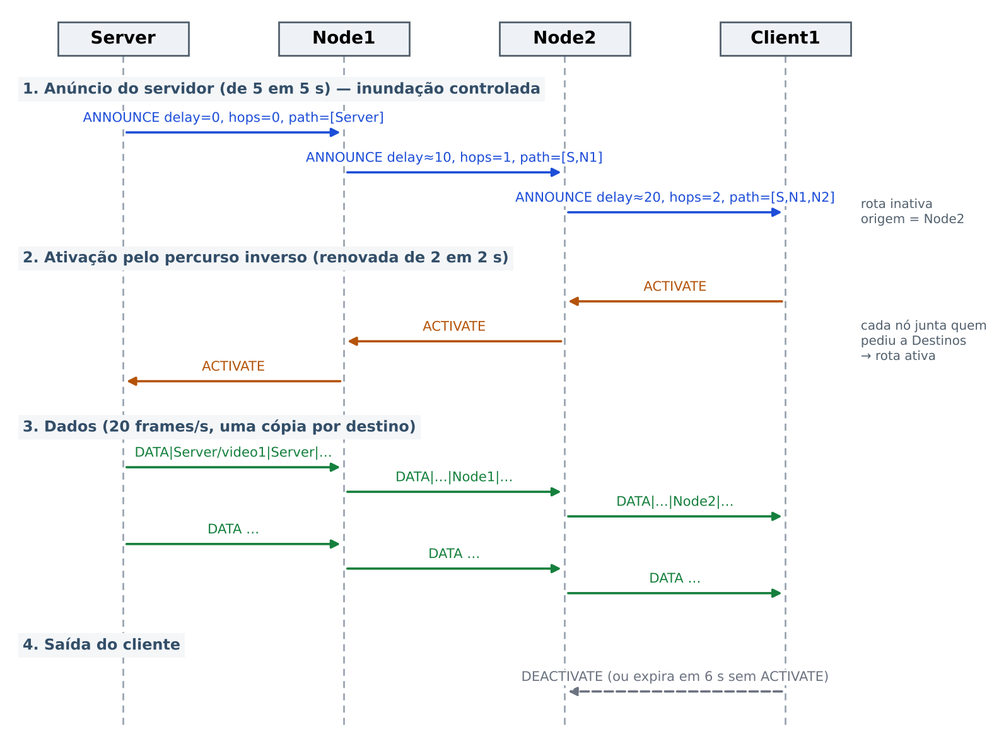{width=88%}

**Anúncio.** De 5 em 5 s o servidor envia, para cada fluxo, um `ANNOUNCE` com `delay = 0`, `hops = 0`, `path = [servidor]` e um número de ronda (`seq`) novo, que começa no relógio do sistema para não recomeçar em 0 se o servidor reiniciar.

**Inundação controlada.** Ao receber um anúncio, um nó soma ao `delay` o atraso medido da ligação por onde ele chegou, soma 1 a `hops`, junta-se ao `path` e guarda o vizinho como candidato. Só reenvia o anúncio aos outros vizinhos (nunca àquele de onde veio) se for a **primeira cópia** dessa ronda ou se trouxer uma **métrica melhor** do que a melhor já vista nessa ronda. Cada cópia é reenviada com a sua própria métrica. Com estas regras, cada ronda termina sozinha e cada ligação transporta no máximo uma ou duas cópias.

**Rotas inativas.** No fim de uma ronda, todos os nós sabem qual é o melhor vizinho para cada fluxo, mas as rotas ficam inativas e não há tráfego de dados.

**Ativação pelo percurso inverso.** O cliente envia `ACTIVATE` à sua origem. Esse nó regista o cliente em Destinos e, se a rota estava inativa, envia `ACTIVATE` à sua própria origem, e assim até ao servidor. O pedido é *soft state*: é renovado de 2 em 2 s, e um destino que não seja renovado durante 6 s é removido. Um cliente que termina envia `DEACTIVATE`; um que morre sem avisar deixa de receber tráfego ao fim de 6 s.

**Replicação.** Cada pacote `DATA` é enviado uma vez a cada destino ativo. Num troço comum segue uma única cópia, e o pacote só é duplicado no nó onde os caminhos se separam. Um pacote que não chegue da origem atual é descartado, o que impede que dados circulem num eventual ciclo.

**PING (Etapa 3).** O servidor envia `PING` pelas rotas ativas. Cada nó junta o seu nome a `path` e escreve o percurso no *log*.

# 6. Métrica

A métrica foi definida com o docente:

1. **1.º critério: atraso.** Ganha o menor atraso desde o servidor.
2. **2.º critério: número de saltos.** Serve apenas para desempatar quando os atrasos são iguais.
3. **Empate nos dois critérios:** qualquer rota serve. Fica a origem atual, o que evita trocas desnecessárias.

**Medição do atraso.** De 1 em 1 s cada nó envia um `PROBE` a cada vizinho com o seu próprio relógio, e o vizinho devolve-o em `PROBE_REPLY`. O RTT é suavizado com uma média móvel exponencial (α = 0,3), e o atraso da ligação é RTT/2. Como cada nó só compara tempos do seu próprio relógio, não é preciso sincronizar relógios.

**Quando são dois atrasos "iguais".** O atraso medido varia sempre um pouco, por isso dois valores contam como iguais se a diferença for no máximo **2 ms ou 10 %** do menor, o que for maior. Sem esta tolerância nunca haveria empates, o 2.º critério nunca seria usado e o ruído das medições faria a rota oscilar. A comparação está em `tabela.py` (`melhor_que` e `_escolher`).

# 7. Prevenção de ciclos e atualização dinâmica

Com o atraso como 1.º critério, uma rota antiga pode parecer melhor do que a verdadeira. Um exemplo é uma rota registada antes de a ligação ter sido medida, que fica com "0 ms". Nos testes de desenvolvimento, isto chegou a formar ciclos entre dois nós. A solução combina três mecanismos:

1. **`path` no anúncio.** Um nó ignora os anúncios que já passaram por ele e retira esse vizinho dos candidatos.
2. **Métrica da própria cópia.** Um anúncio é reenviado com a métrica da cópia recebida, nunca com uma rota guardada de uma ronda anterior.
3. **Só conta a ronda atual**, como no DSDV. Apenas os candidatos que anunciaram na ronda atual (o mesmo `seq`) podem ser escolhidos como origem. A origem atual tem 1 s de tolerância no início de cada ronda, à espera da sua cópia, e mantém-se se nenhuma cópia chegar (por exemplo, por perda de um anúncio).

| Acontecimento | Reação do *router* |
|---|---|
| Vizinho cai (6 s sem HELLO) ou sai (`LEAVE`) | Remove-o da tabela, escolhe outra origem entre os candidatos e envia `ACTIVATE` pelo novo caminho e `DEACTIVATE` pelo antigo |
| Ligação fica mais lenta ou mais rápida | O `PROBE` mede o novo atraso e o `ANNOUNCE` seguinte escolhe o novo melhor caminho |
| Servidor deixa de anunciar | A rota expira ao fim de 15 s (3 rondas) |
| Cliente desaparece | O destino expira ao fim de 6 s e os ramos sem clientes desligam-se |

# 8. Testes e resultados

## 8.1 Testes automáticos

O `test_routing.py` tem **27 testes** que correm em cerca de 3 s, sobre uma rede simulada em memória com atraso configurável por ligação. Cobrem os critérios da métrica, a acumulação do atraso, a ativação e desativação, o *soft state*, a replicação sem duplicados, o *failover*, o PING, o cenário final com 2 servidores × 2 fluxos, e a ausência de ciclos com atrasos e falhas aleatórios.

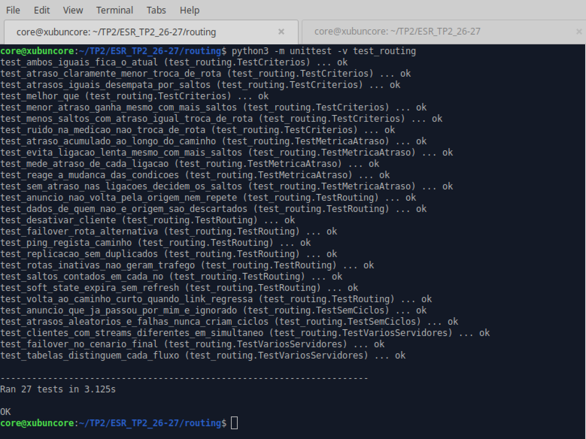{width=60%}

Num teste adicional com 30 redes aleatórias (cenário final, atrasos entre 0 e 80 ms, ligações a falhar), não houve ciclos fora do 1.º segundo de cada ronda em 12 000 verificações. Nesse 1.º segundo pode existir um ciclo transitório, mas os dados não circulam, porque cada nó só aceita pacotes vindos da sua origem.

## 8.2 Cenário de teste

Os testes no CORE usaram o **Cenário 2** (`topology/Cenario_2.xml`). Todas as ligações do XML têm **10 ms** de atraso e 10 Mbit/s. Os nós foram arrancados com o `ott.py`: o Server como *bootstrapper* e servidor do fluxo `Server/video1`, os Node1–Node3 como nós intermédios, e o Client1 e o Client2 a pedir o fluxo.

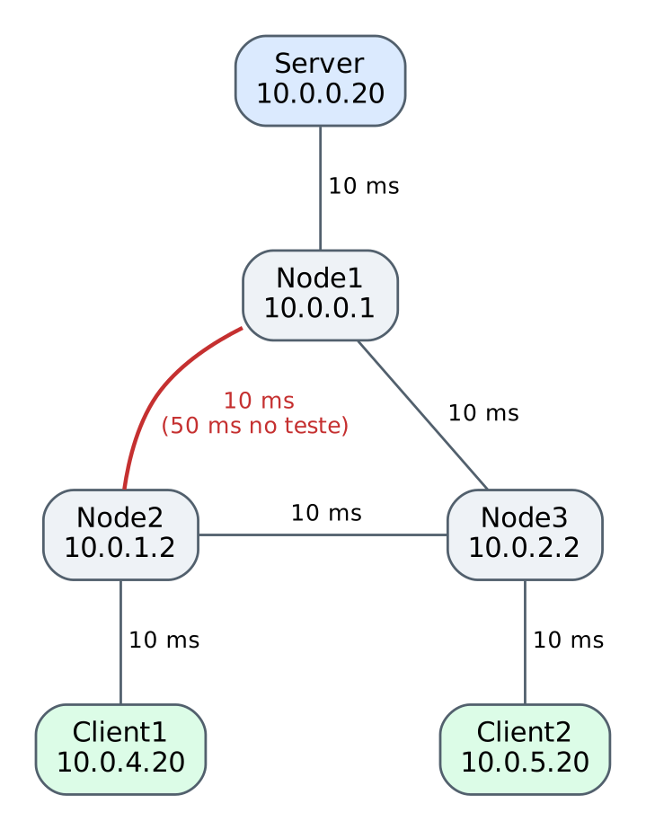{width=42%}

## 8.3 Tabelas de rotas (P2)

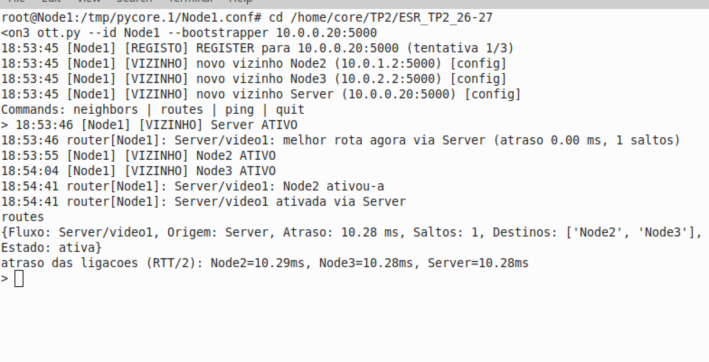{width=82%}

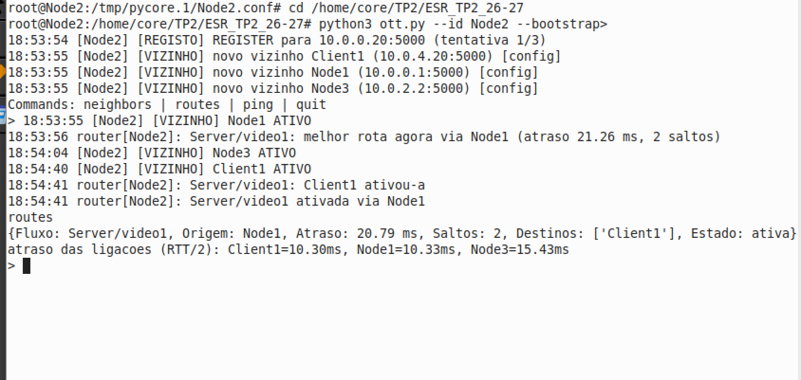{width=82%}

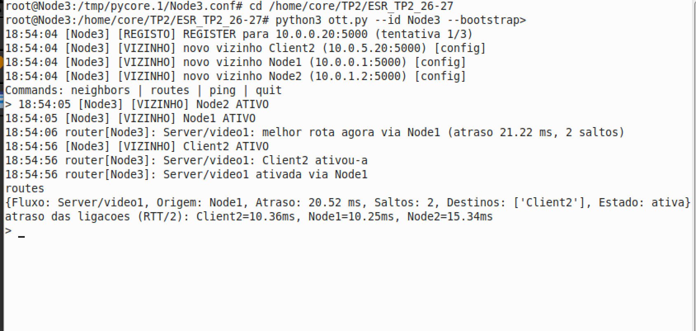{width=82%}

As tabelas mostram a árvore de distribuição esperada: Server → Node1 → {Node2 → Client1, Node3 → Client2}. Os atrasos medidos batem com a configuração: cerca de 10,3 ms por ligação e cerca de 20,5 ms do servidor até ao Node2 e ao Node3.

A ligação lógica Node2–Node3 mede **15,4 ms** em vez de 10 ms. A razão é explicada na secção 9.

## 8.4 PING (P3)

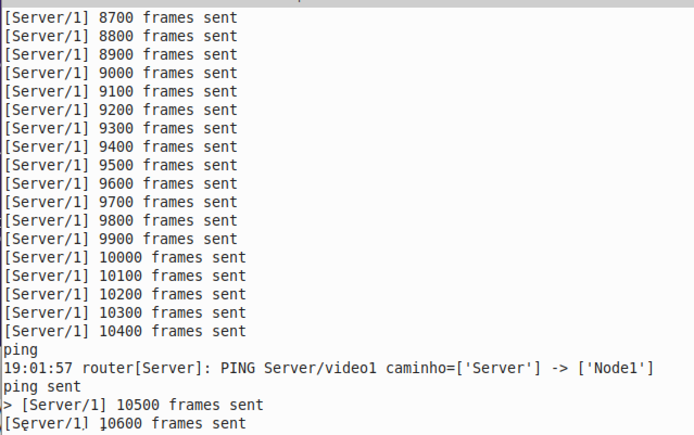{width=62%}

![PING recebido no Client1: `['Server', 'Node1', 'Node2', 'Client1']`.](figuras/P3-client1.png){width=82%}

![PING recebido no Client2: `['Server', 'Node1', 'Node3', 'Client2']`.](figuras/P3-client2.png){width=82%}

Cada cliente regista o percurso completo do PING, que coincide com as tabelas da secção 8.3. Os clientes mostram também um atraso de ponta a ponta de **39–40 ms** por *frame*: 30 ms de propagação (3 ligações de 10 ms) mais o tempo de transmissão de *frames* de cerca de 7 KB em ligações de 10 Mbit/s.

## 8.5 Rotas inativas (P4)

![Node1: depois de os clientes saírem (`Node3/Node2 desativou-a`), a rota fica `Destinos: [], Estado: inativa`.](figuras/P4.png){width=90%}

Quando os dois clientes terminaram, o `DEACTIVATE` subiu até ao Node1 e a rota ficou inativa. A partir daí o servidor deixa de enviar o vídeo. A rota continua na tabela, pronta a ser reativada.

## 8.6 Replicação (P5)

Para medir a replicação, foram contados com `tcpdump` os pacotes de vídeo (> 1000 bytes) na interface do Node1 virada para o servidor, durante 10 s, primeiro com um cliente e depois com dois.

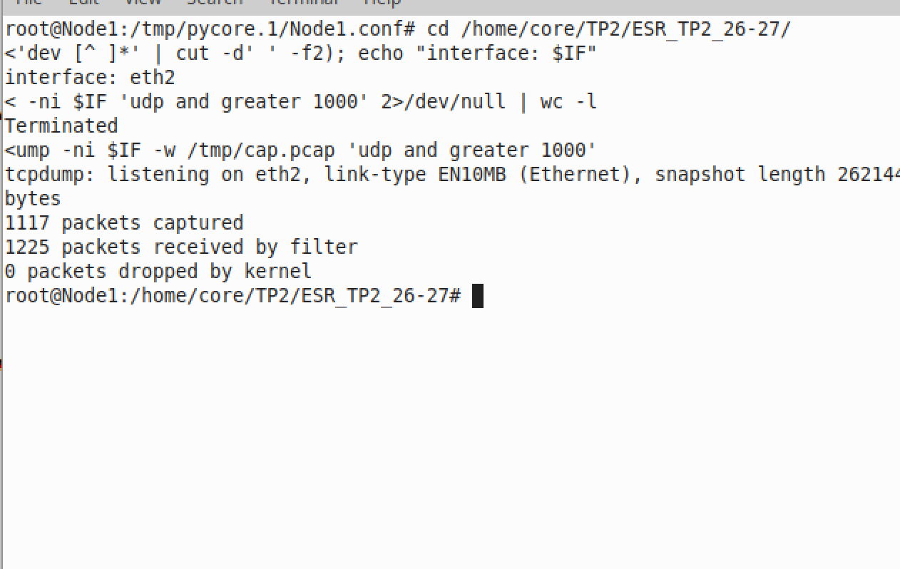{width=62%}

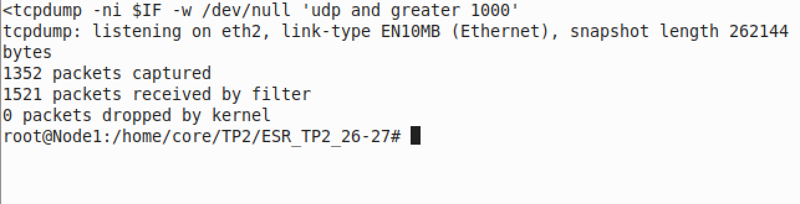{width=62%}

| Clientes | Pacotes em 10 s (Server → Node1) |
|---|---|
| 1 | 1117 |
| 2 | 1352 |
| Esperado com **uma** cópia (calculado a partir do `movie.Mjpeg`) | 1015 – 1557 |
| Esperado com uma cópia **por cliente** | 2030 – 3114 |

Os *frames* do vídeo têm entre 5 e 14 KB, por isso o número de fragmentos por segundo depende da parte do vídeo que está a passar. Os dois valores medidos estão dentro do intervalo de uma única cópia e longe do dobro. Isto confirma que o servidor envia uma só cópia e que a duplicação acontece no Node1, onde os caminhos se separam.

## 8.7 Critério 1: atraso (P6)

No CORE, o atraso da ligação Node1–Node2 passou de 10 ms para **50 ms**.

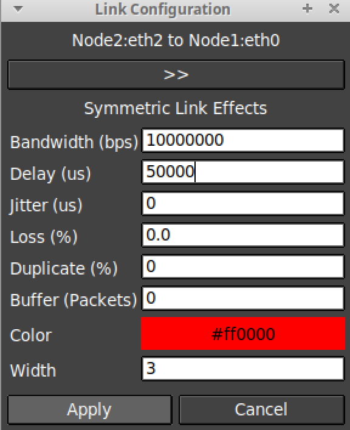{width=30%}

**1.ª tentativa: a rota manteve-se no Node1.**

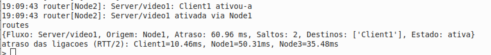{width=88%}

Pelas contas do Node2, a rota pelo Node1 vale 10 + 50 ≈ 61 ms (2 saltos) e a rota pelo Node3 vale 20 + 35 ≈ 55 ms (3 saltos). A diferença, cerca de 5,5 ms, fica dentro da tolerância de 10 %, por isso os atrasos contam como iguais, desempata o número de saltos e ganha o Node1. A decisão está correta segundo a métrica. O facto de a ligação ao Node3 medir 35 ms, e não 10 ms, é explicado na secção 9.

**2.ª tentativa: com o tráfego Node2–Node3 forçado pela ligação direta** (`ip route replace 10.0.2.2/32 via 10.0.3.2` no Node2 e `ip route replace 10.0.1.2/32 via 10.0.3.1` no Node3).

{width=88%}

Às 19:23:09 o Node2 passou a receber o fluxo pelo Node3: **3 saltos com cerca de 32 ms** em vez de 2 saltos com cerca de 61 ms. No mesmo instante, o *log* do Node1 regista `Node2 desativou-a`. O caminho mais longo foi escolhido por ser mais rápido, o que mostra que **o atraso tem prioridade sobre o número de saltos**. O vídeo no Client1 não foi interrompido.

## 8.8 Critério 2: desempate por saltos (P7)

O atraso da ligação Node1–Node2 voltou a 10 ms.

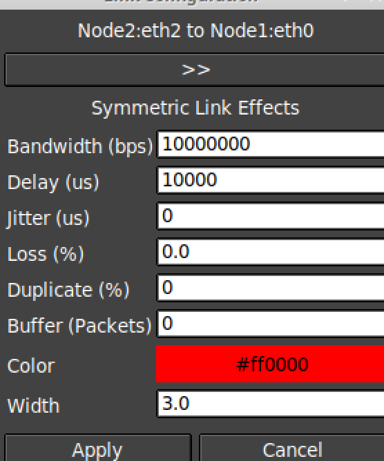{width=30%}

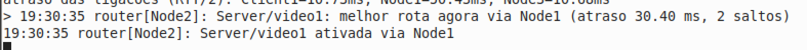{width=88%}

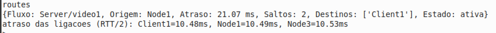{width=88%}

A mudança das 19:30:35 é um exemplo direto do 2.º critério. A média móvel do atraso da ligação ainda estava a descer, por isso a rota pelo Node1 valia 30,40 ms e a rota pelo Node3 cerca de 32 ms. A diferença, 1,8 ms, é menor do que a tolerância de 2 ms: os atrasos contam como iguais e **ganha o caminho com menos saltos** (2 contra 3). Depois de a medição estabilizar, o Node1 passa a ganhar também pelo atraso (21 contra 31 ms).

## 8.9 Falha de um nó (P8)

Foram feitos três testes com os clientes a receber vídeo. Um nó intermédio sai ou é morto, e mede-se quanto tempo o cliente fica sem vídeo.

**Teste A: saída controlada do Node2** (`Ctrl+C`; o nó envia `LEAVE` aos vizinhos antes de terminar).

{width=82%}

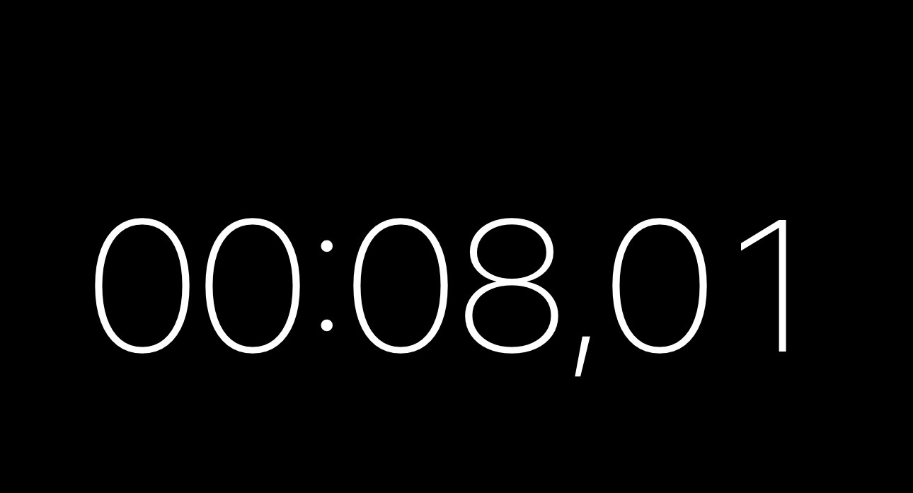{width=30%}

Os vizinhos souberam da saída de imediato, pelo `LEAVE`. O Client1 ficou sem vizinhos, pediu um substituto ao *bootstrapper* e recebeu o Node1 cerca de 3 s depois (*log* do Node1: `19:38:27 novo vizinho Client1 [aprendido]`). Ter um vizinho novo não chega para receber vídeo: o Client1 só aprende a rota por ele no `ANNOUNCE` seguinte, o que pode levar até 5 s. Daí os cerca de 8 s sem vídeo.

**Teste B: avaria do Node2** (`kill -9`, sem aviso).

{width=82%}

{width=82%}

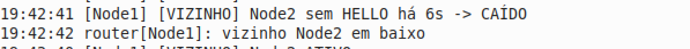{width=82%}

A queda foi detetada **6 s** depois, pelo fim dos HELLO. O vídeo do Client1 **não parou**. Depois do teste A, o Client1 ficou com dois vizinhos: o Node1 (substituto) e o Node2 (quando voltou). O *routing* escolheu o Node1: os atrasos eram iguais, cerca de 31 contra 32 ms, e o Node1 tinha menos saltos, 2 contra 3. O Client1 já não dependia do Node2. A ligação lógica Client1–Node1 passa fisicamente pela máquina Node2, mas o *router* IP dessa máquina continua a encaminhar pacotes sem o processo `ott.py` (ver secção 9).

**Teste C: avaria do Node3** (`kill -9`). O Client2 só tinha o Node3 como vizinho.

{width=82%}

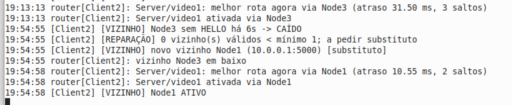{width=92%}

{width=82%}

| Hora | Acontecimento | Módulo |
|---|---|---|
| 19:54:48 | `kill -9` ao Node3 | — |
| 19:54:54 | Node1: `Node3 sem HELLO há 6s -> CAÍDO` | *overlay* |
| 19:54:55 | Client2: deteta a queda, tem 0 vizinhos e pede substituto; recebe o Node1 `[substituto]` | *overlay* |
| 19:54:58 | Client2: `melhor rota agora via Node1` e `ativada via Node1`; Node1: `Client2 ativou-a` | *routing* |

O vídeo voltou ao Client2 cerca de **10 s** depois da falha: cerca de 7 s para detetar a queda, menos de 1 s para obter o substituto, e cerca de 3 s à espera do `ANNOUNCE` seguinte para ter uma rota pelo vizinho novo. A primeira métrica pelo Node1 (10,55 ms) não incluía ainda o atraso da ligação nova, que só começa a ser medida com o primeiro `PROBE`. O valor corrige-se nas rondas seguintes.

| Teste | Tipo de falha | Deteção | Tempo sem vídeo |
|---|---|---|---|
| A | Saída controlada (`LEAVE`) | imediata | ≈ 8 s (cronómetro) |
| B | Avaria do Node2 | 6 s | 0 s: o Client1 já recebia pelo Node1 |
| C | Avaria do Node3 | 6–7 s | ≈ 10 s (pelos *logs*) |

O tempo de recuperação é dominado pela deteção da falha, que é do *overlay* (HELLO de 2 em 2 s, queda ao fim de 6 s), e pela espera pelo `ANNOUNCE` seguinte. A secção 10 propõe duas formas de o reduzir.

# 9. Discussão: *overlay* e rede IP por baixo

O *overlay* atribui **um único endereço IP a cada nó** (o do `cenario2.json`). No Cenário 2, o endereço do Node3 é 10.0.2.2, a interface dele na ligação **Node1–Node3**, e o do Node2 é 10.0.1.2, na ligação **Node1–Node2**. Para chegar a esses endereços, o OSPF da rede IP tem dois caminhos com o mesmo custo e pode escolher o que passa pelo Node1, sem considerar o atraso. Assim, a ligação lógica Node2–Node3 do *overlay* nem sempre usa o cabo direto entre os dois nós:

* **Sem alterações** (P2): ida pelo Node1 (20 ms) e volta direta (10 ms), o que dá RTT/2 = **15,4 ms**.
* **Com 50 ms no link Node1–Node2** (P6b): ida 60 ms e volta 10 ms, o que dá RTT/2 = **35,5 ms**. Por isso a alternativa pelo Node3 parecia também lenta e a rota não mudou na 1.ª tentativa.

O atraso medido pelo `PROBE` é o do caminho IP real, que é precisamente o que o vídeo vai percorrer. A métrica comportou-se corretamente: o problema está na correspondência entre ligações lógicas e físicas. O mesmo efeito explica porque é que matar o processo de um nó não corta o tráfego que atravessa essa máquina ao nível IP (secção 8.9). Duas formas de evitar isto são permitir no ficheiro de configuração um endereço por vizinho (o da ligação partilhada) ou fixar rotas IP entre vizinhos do *overlay*, como foi feito na 2.ª tentativa do teste de atraso.

# 10. Limitações e trabalho futuro

* **Tempo de deteção de falhas:** um vizinho só é dado como em baixo ao fim de 6 s sem HELLO. O *router* já envia `PROBE` de 1 em 1 s e poderia declarar a queda ao fim de 3 `PROBE` sem resposta (cerca de 3 s).
* **Rota por um vizinho novo:** hoje só chega no `ANNOUNCE` seguinte (até 5 s; 3 s no teste C). Um nó que ganha um vizinho podia enviar-lhe logo os anúncios das rotas que conhece (*triggered update*), poupando esse tempo.
* **Tempo de reação a mudanças de atraso:** a média móvel e o período de `ANNOUNCE` (5 s) fazem com que uma mudança de rota demore entre alguns segundos e cerca de 20 s. É um compromisso entre estabilidade e rapidez.
* **A métrica não considera perdas nem largura de banda.** Contar os `PROBE` sem resposta permitiria penalizar ligações com perdas.
* **Um endereço por nó no *overlay*:** ver a secção 9.
* **Ciclos transitórios** podem ocorrer no 1.º segundo de cada ronda após uma mudança, sem circulação de dados.
* **Clientes com um só vizinho** dependem do *bootstrapper* para recuperar de uma falha (`min_degree = 1` nos cenários).

# 11. Conclusão

O módulo de *routing* cumpre os requisitos das Etapas 2 e 3, como confirmaram os testes no CORE e os 27 testes automáticos (estes também em topologias maiores e com falhas aleatórias):

* constrói rotas por fluxo a partir de anúncios periódicos do servidor, com inundação controlada;
* mantém uma tabela com Fluxo, Origem, Métrica, Destinos e Estado;
* ativa só os ramos com clientes, pelo percurso inverso;
* replica o vídeo apenas onde os caminhos se separam;
* adapta as rotas a falhas e a mudanças de atraso, segundo a métrica definida (1.º atraso, 2.º saltos).
